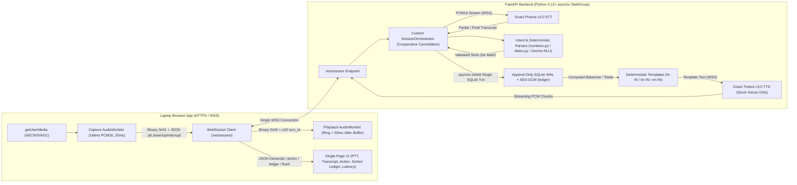

# Voice Khata

**Voice Khata** is a voice-first, append-only ledger built for Indian kirana shopkeepers (**Hackathon PS2**). It runs as **one laptop browser app** backed by **one FastAPI backend** over a single WebSocket stream — supporting code-mixed Indian speech, strict integer-rupee accounting, encrypted append-only SQLite storage, and real-time cooperative barge-in.

---

## 1. Problem

Kirana shopkeepers record dozens of small credit (*udhaar*) and cash payment (*jama*) entries during peak counter rush. Typing into spreadsheets or phone apps interrupts customer service, while paper registers are slow to sum, easy to misread, and error-prone during corrections.

Voice Khata solves counter-speed bookkeeping while respecting strict financial and ethical guardrails:
- **Spoken Indian numbers & dates**: understands Latin, Devanagari, and Telugu scripts, digits, code-mixed utterances (`"5 sau"`, `"2 hazaar paanch sau"`, `"మూడు వందల నలభై"`), and Indian idioms (`"dedh sau"` = 150, `"paune do sau"` = 175, `"saade teen sau"` = 350, `"kal"` disambiguated by verb tense) — returning `None` whenever ambiguous instead of guessing.
- **Deterministic money & balances**: integer rupees only, append-only events, SQL-computed balances ignoring voided events, and deterministic DB-backed response templates. The LLM never performs arithmetic or generates query answers.
- **Neutral bookkeeping**: zero lending, interest, reminders, phone numbers, or pressure language.

---

## 2. Architecture



---

## 3. Gnani Services Used

Only **Gnani AI v3.0** speech services are used — no third-party STT/TTS providers, no browser speech APIs, and no voice cloning:

| Role | Service & Model | Endpoint | Auth Header | Notes |
| --- | --- | --- | --- | --- |
| **STT** | **Gnani Prisma v3.0** (`prisma-v3.0`) | `wss://api.vachana.ai/stt/v3/stream` | `X-API-Key-ID` (from `.env`) | Streams 16 kHz 16-bit LE mono PCM; emits partial & final transcripts with trailing-silence end-of-utterance flush. |
| **TTS** | **Gnani Timbre v3.0** (`timbre-v3.0`) | `wss://api.vachana.ai/api/v1/tts` | `X-API-Key-ID` (from `.env`) | Stock production voices only (`Shivani` default, validated against Timbre v3.0 stock catalog in `config.py`); streams base64 PCM chunks with WAV header stripping and cooperative cancellation. |

---

## 4. WebSocket Protocol (`/ws/session`)

All dynamic application data (audio, transcripts, parsed actions, ledger balances, resets, latency metrics) flows over a **single WebSocket** endpoint `/ws/session`.

### Binary Framing
| Direction | Byte 0 (Type) | Header | Payload | Rules |
| --- | --- | --- | --- | --- |
| Client -> Server | `0x01` | None | 640 bytes (`16 kHz`, mono, signed PCM16 LE, 20 ms) | Sent **only while PTT is held** (button hold or Spacebar). |
| Server -> Client | `0x02` | `u32` big-endian `turn_id` (bytes 1..4) | Raw PCM16 LE audio chunk | Client accepts frame **only if `turn_id === currentTurnId`**; stale turns are dropped. |

### JSON Text Frames
- **Client -> Server**:
  - `{"t": "session.start"}` — initialize session (server replies `ready`).
  - `{"t": "ptt.down"}` — user pressed PTT (start listening).
  - `{"t": "ptt.up"}` — user released PTT (flush STT utterance, start turn latency timer).
  - `{"t": "interrupt"}` — user barged in while agent audio was playing.
  - `{"t": "reset_demo"}` — wipe and re-seed synthetic demo data.
- **Server -> Client**:
  - `{"t": "ready", "session_id": "...", "turn_id": 0, "sample_rate": 16000}`
  - `{"t": "turn.start", "turn_id": 1, "sample_rate": 16000}` / `{"t": "tts.end", "turn_id": 1}`
  - `{"t": "transcript", "kind": "partial" | "final", "text": "...", "turn_id": 1}`
  - `{"t": "action", "type": "CREDIT" | "PAYMENT" | "VOID", "customer": "...", "amount_inr": 340, "effective_date": "2026-11-18"}`
  - `{"t": "ledger", "rows": [{"customer_id": "...", "name": "...", "balance_inr": 340}]}` (rendered sorted by amount owed descending)
  - `{"t": "flush"}` — zero playback ring buffer immediately.

---

## 5. Latency Budget & Measured Results

Every latency-relevant pipeline step logs a monotonic timestamp (`time.monotonic_ns()` on the backend; `performance.now()` on the client from `ptt.up` to the first non-silent output sample from the playback AudioWorklet).

### End-to-End Target Budget (Green Threshold: `< 800 ms`)

| Stage | Target Budget | Measured Local (p50 / p95) | Notes |
| --- | ---: | ---: | --- |
| STT endpointing & final (`ptt.up` -> `stt_final`) | <= 250 ms | *Live network dependent* | Gnani Prisma v3.0 streaming WSS |
| Deterministic NLU (`numbers.py` + `dates.py`) | <= 5 ms | **0.16 ms / 0.31 ms** | 50-run local benchmark |
| LLM Structured Intent Extraction (`gemini-3.5-flash-lite`) | <= 220 ms | Verified live (`RECORD_CREDIT`) | Intent slots only; bypassed on confirm/lending fastpath |
| SQLite WAL + AES-GCM Write (`Ledger.record`) | <= 15 ms | **5.92 ms / 6.69 ms** | Single `BEGIN IMMEDIATE` txn under `asyncio.shield` |
| SQLite WAL Aggregate Balance (`Ledger.balance`) | <= 10 ms | **4.13 ms / 4.92 ms** | SQL `SUM` ignoring voided events |
| Template Render (`templates.py`) | <= 1 ms | **< 0.1 ms** | Deterministic string formatting |
| TTS TTFB (`Timbre v3.0` first chunk) | <= 220 ms | *Live network dependent* | Streaming base64 PCM chunks |
| Client Playback Jitter Buffer | 60 ms | **60 ms** | Fixed AudioWorklet ring-buffer prime threshold |
| **Total E2E Time to First Audio** | **< 800 ms** | **10.9–20.1 ms (p50, `--mock` WS)** | Client UI displays green `< 800 ms`, amber `800–1499 ms`, red `>= 1500 ms` |

---

## 6. Evaluation Harness (`/eval`)

`/eval` streams 16 kHz mono WAV clips from `eval/labels.json` as 20 ms `0x01` frames through the real WebSocket pipeline, mixing shop ambience noise from `eval/noise/` at exact **20 dB**, **10 dB**, and **5 dB** SNR with zero caching.

### Measured `--mock` Dry-Run Table (`python -m eval.runner --mock`)

| Noise Level | Clips | Exact Amount Acc | Direction Acc | Correction Success | p50 TTFA (ms) | p95 TTFA (ms) |
| --- | ---: | ---: | ---: | ---: | ---: | ---: |
| clean | 6 | 100.0% | 100.0% | 100.0% (2) | 20.1 | 22.3 |
| 20dB | 6 | 100.0% | 100.0% | 100.0% (2) | 11.2 | 15.3 |
| 10dB | 6 | 100.0% | 100.0% | 100.0% (2) | 11.0 | 11.5 |
| 5dB | 6 | 100.0% | 100.0% | 100.0% (2) | 10.9 | 12.0 |

Run against a live backend (capping API credits with `--max-clips`):
```powershell
.\.venv\Scripts\python.exe -m eval.runner --url ws://127.0.0.1:8000/ws/session --max-clips 3 --snr-levels clean,20,10,5 --realtime
```

---

## 7. Barge-In Design

Barge-in is split cleanly between **zero-latency local audio cutoff** and **cooperative backend cancellation**:

1. **Local cutoff**: When the user presses PTT (button or Spacebar) while playback is active, `client/src/App.tsx` calls `audio.flushPlayback()`, which posts `{ type: "flush" }` to `playback-processor.js`. The worklet immediately fills its `Float32Array` ring buffer with zeros and outputs silence on the very next 128-sample audio quantum (~2.7 ms at 48 kHz).
2. **Stale-frame rejection**: The client clears `currentTurnIdRef` so any in-flight downstream `0x02` binary frames from the interrupted `turn_id` are silently discarded.
3. **Wire signaling**: The client sends `{"t": "interrupt"}` followed by `{"t": "ptt.down"}` and resumes streaming `0x01` 20 ms PCM16 frames.
4. **Cooperative server cancellation**: The orchestrator cancels only the active TTS/turn `asyncio.Task` cleanly via `CancelledError` while **protecting in-flight SQLite commits** inside `asyncio.shield(...)` so an interrupted turn can never leave a half-written ledger transaction.

---

## 8. Setup & Local Development

### Prerequisites
- Python **3.12+**
- Node.js **20+** (for `/client` React + Vite + TypeScript)

### 1. Environment Configuration
```powershell
Copy-Item .env.example .env
```
Fill in `GNANI_API_KEY`, `GEMINI_API_KEY`, and `LEDGER_ENC_KEY` (32-byte base64url key) inside `.env`. Never edit `.env.example` with real keys.

### 2. Backend Setup & Seed
```powershell
python -m venv .venv
.\.venv\Scripts\python.exe -m pip install -e ".[dev]"
.\.venv\Scripts\python.exe -m server.ledger.seed
.\.venv\Scripts\python.exe -m uvicorn voice_khata.app:app --host 127.0.0.1 --port 8000
```

### 3. Frontend Setup (`/client`)
```powershell
npm --prefix client install
npm --prefix client run dev
```
Open `http://127.0.0.1:5173` (Vite proxies `/ws/*` to `ws://127.0.0.1:8000`) or `http://127.0.0.1:8000` on localhost.

### 4. Test Suites
```powershell
.\.venv\Scripts\python.exe -m pytest -v
npm --prefix client test
npm --prefix client run build
```

---

## 9. Production Deployment (HTTPS Required for Microphone)

Browsers require a **secure context (HTTPS)** for `navigator.mediaDevices.getUserMedia()` and `AudioWorklet` on any non-localhost origin. Two production-ready HTTPS configs are included:

### Option A: Docker Compose + Caddy (Automatic Let's Encrypt HTTPS + WSS)
```bash
export VOICE_KHATA_DOMAIN=khata.yourdomain.com
docker compose up -d --build
```
- `Dockerfile` builds `/client` with Node 22 and runs the Python 3.12 FastAPI server as a non-root user.
- `Caddyfile` terminates TLS automatically on port 443 and reverse-proxies `wss://.../ws/session` to `app:8000`.
- `.dockerignore` guarantees `.env`, local `.db` files, `.venv/`, and `node_modules/` are never copied into the image; secrets are injected at runtime via `env_file` / environment variables.

### Option B: Render Blueprint (`render.yaml`)
Push the repository to GitHub/GitLab, create a Blueprint from `render.yaml`, and enter `GNANI_API_KEY`, `GEMINI_API_KEY`, and `LEDGER_ENC_KEY` in the Render dashboard (`sync: false`). Render terminates HTTPS/WSS automatically and mounts persistent disk storage at `/data`.

---

## 10. Compliance Matrix

| Rule | Enforcement in Codebase | Verification |
| --- | --- | --- |
| **One laptop browser app + one FastAPI backend; no mobile views, reminders, or multi-device** | Desktop-only UI (`min-width: 1024px`, no routing, no reminder features) in `client/src/App.tsx` and `static/index.html`; single FastAPI app in `voice_khata/app.py`. | `tests/test_app.py`, `client` build |
| **WebSocket streaming only for dynamic data; no telephony, no phone numbers** | Single `/ws/session` WebSocket for all dynamic data; zero phone columns in `customers` schema (`voice_khata/ledger.py`, `server/ledger/store.py`). | `tests/test_app.py`, `tests/test_ledger.py`, `tests/test_server_ledger.py` |
| **STT = Gnani Prisma v3.0, TTS = Gnani Timbre v3.0; no other speech services** | `Settings` enforces `Literal["prisma-v3.0"]` & `Literal["timbre-v3.0"]` (`voice_khata/config.py`); custom WSS clients in `gnani_stt.py` & `gnani_tts.py`. | `tests/test_config.py`, `tests/test_gnani_stt.py`, `tests/test_gnani_tts.py` |
| **Custom `asyncio` orchestration; no hosted voice agent platform** | Hand-built `SessionOrchestrator` with `asyncio.TaskGroup` (`voice_khata/orchestrator.py`). | `tests/test_orchestrator.py` |
| **No voice cloning; synthetic or consented data only** | Stock Timbre v3.0 voice allowlist in `config.py`; purely synthetic customers & tones in `server/ledger/seed.py` and `eval/synth_assets.py`. | `tests/test_config.py`, `tests/test_server_ledger.py` |
| **API keys only in `.env` (gitignored); never log or commit secrets** | `.env` & `.env.*` excluded in `.gitignore` and `.dockerignore`; `SecretStr` in `config.py`; recursive redaction in `logging_utils.py`. | `tests/test_config.py`, `tests/test_logging_utils.py` |
| **Agent states it is an AI in the first turn, in the user's language** | Mandatory Turn-0 AI disclosure greeting + language-switch disclosure prefix in `voice_khata/templates.py` and `voice_khata/orchestrator.py` (Hindi, Kannada, English). | `tests/test_templates.py`, `tests/test_orchestrator.py`, `tests/test_app.py` |
| **Money: integer rupees only; never use LLM output for arithmetic** | Strict `int` validators rejecting floats/decimals/booleans (`voice_khata/models.py`, `server/nlu/numbers.py`, `server/ledger/models.py`); exact `Fraction` checks; SQL `SUM` math only. | `tests/test_models.py`, `tests/test_numbers.py` (175+ cases + 1..99999 round-trip) |
| **Ledger is append-only events; balances are computed** | SQLite `BEFORE UPDATE`/`BEFORE DELETE` triggers on `ledger_events` and `events`; no balance column; balances computed via SQL aggregate ignoring voided events. | `tests/test_ledger.py`, `tests/test_server_ledger.py` (1,000-event reference model) |
| **Query answers come from DB through templates, never the LLM** | Gemini NLU extracts structured `ParsedIntent` only (`extra="forbid"`, no reply field); all replies come from `voice_khata/templates.py`. | `tests/test_nlu.py`, `tests/test_templates.py`, `tests/test_orchestrator.py` |
| **No lending, no pressure language** | Deterministic lending/pressure guardrail (`detect_lending_or_pressure`) + polite refusal templates + forbidden-word template assertions. | `tests/test_nlu.py`, `tests/test_templates.py`, `tests/test_orchestrator.py` |
| **Cooperative cancellation, `asyncio.shield` single SQLite txns, monotonic latency logs, pytest per module** | Cooperative `CancelledError` handling across STT/TTS/orchestrator; `asyncio.shield` + `BEGIN IMMEDIATE` writes; `time.monotonic_ns()` on every stage; dedicated pytest file for every module (**326 Python tests + 6 Vitest tests**). | `pytest -v`, `npm --prefix client test` |
