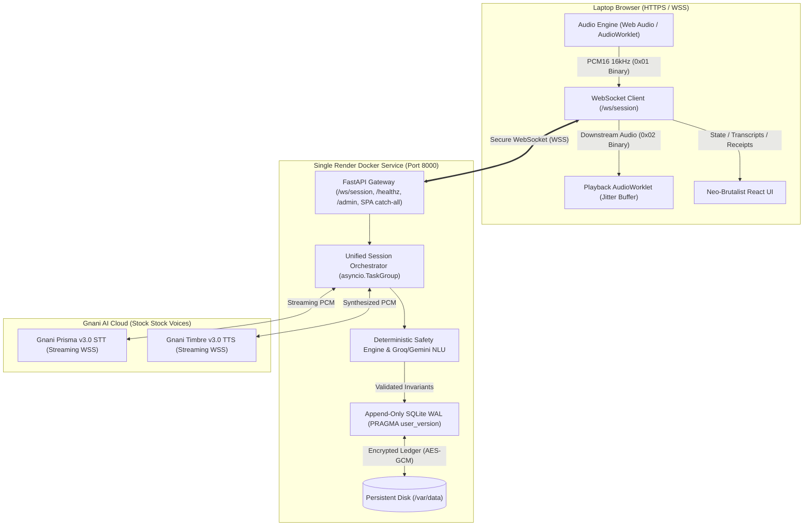

# Voice Khata (KhataSaathi)

[](https://render.com/deploy?repo=https://github.com/prajwalbhagwathofficial-max/voice---khata)
[](https://www.python.org/downloads/)
[](https://fastapi.tiangolo.com/)
[](https://vitejs.dev/)
[](https://github.com/prajwalbhagwathofficial-max/voice---khata)
[](LICENSE)

> **Voice-first, mistake-resistant ledger for Indian kirana storekeepers (Hackathon PS2).**  
> *Product thesis: Speech recognition is a component; trustworthy transaction execution is the product.*

---

## 🌟 Overview

**Voice Khata** is a production-ready, single-origin web application deployed as a **single Render Docker service**. It delivers real-time voice accounting at counter speed, handling code-mixed Indian speech across Hindi, Kannada, Telugu, and English.

- **Deterministic Financial Code**: Models propose meaning; deterministic code owns money arithmetic, customer identity resolution, transaction commits, and balance updates. No LLM-generated SQL or text ever touches the ledger.
- **Append-Only Accounting**: The ledger never mutates or deletes rows. Corrections append a `REVERSAL` event plus a new event. Balances are strictly calculated in integer paise (`₹1 = 100 paise`).
- **Single-Origin Deployment**: Serves the FastAPI WebSocket backend, the compiled Vite React frontend, and an encrypted SQLite database from one host and URL with zero CORS, no second origin, and persistent disk mounting.
- **Zero Telephony / Zero Phone Storage**: Pure WebSocket browser audio, zero telephony dependencies, no phone numbers stored on disk, and privacy-preserving field-level AES-256-GCM encryption.

---

## 🏗️ Architecture



---

## 🚀 One-Click Deploy to Render

Deploy this repository directly to Render as a unified Docker service with a persistent 1GB disk:

[](https://render.com/deploy?repo=https://github.com/prajwalbhagwathofficial-max/voice---khata)

### What `render.yaml` Provisions Automatically:
1. **1 Web Service**:
   - Runtime: `Docker` (Multi-stage build)
   - Region: `singapore`
   - Plan: `starter`
   - Health Check Path: `/healthz`
   - Auto Deploy: `true`
2. **Persistent Disk**:
   - Name: `khata-data`
   - Mount Path: `/var/data`
   - Size: `1 GB`
3. **Environment & Secrets**:
   - `DATA_DIR=/var/data`
   - `USE_MOCKS=false`
   - `STT_MODE=transcribe`
   - Prompts for secrets marked `sync: false`:
     - `GNANI_API_KEY` (Gnani Speech AI API key)
     - `GROQ_API_KEY` (Groq API key for structured intent slots)
     - `DB_ENCRYPTION_KEY` (32-byte Base64 key for SQLite field encryption)
     - `ADMIN_TOKEN` (Bearer token for `/admin/export` and `/admin/wipe`)
     - `ACCESS_CODE` (Optional shop pin)

---

## 🛡️ Financial & Ethical Rules (AGENTS.md)

1. **Integer Paise Only**: Positive balance = customer owes the shop.
   $$\text{Outstanding} = \sum(\text{credit\_given}) - \sum(\text{payment\_received})$$
   Floats are completely forbidden in financial logic.
2. **Never Guess Silently**: If an amount, customer name, or direction is ambiguous, the system asks for clarification. Clarification is considered a successful outcome.
3. **Append-Only Invariant**: Events are immutable. Triggers enforce `BEFORE UPDATE` and `BEFORE DELETE` prohibitions on SQLite tables. Corrections append a `REVERSAL` event.
4. **AI Disclosure on Turn 0**: In the user's spoken language, the system immediately announces itself as an AI assistant on the first turn.
5. **No Lending / No Pressure**: Zero lending calculations, zero interest, zero threats or pressure language (`police`, `court`, `legal`, `notice`, `chor`, `fir` are strictly blocked).
6. **No Raw Audio Retention**: Ephemeral audio processing only; audio bytes are discarded immediately after transcription.

---

## ⚡ WebSocket Protocol (`/ws/session`)

All dynamic data flows over a single WebSocket endpoint `/ws/session`.

### Binary Frames
| Type | Header | Payload | Purpose |
| --- | --- | --- | --- |
| `0x01` | None | PCM16 LE (16 kHz, mono, 20ms chunks) | Upstream microphone audio during PTT |
| `0x02` | `u32` BE `turn_id` | PCM16 LE Audio Chunk | Downstream TTS audio playback with turn tracking |
| `0x03` | `u32` BE `upload_id`| Binary Chunk | Upstream bill attachment streaming |
| `0x04` | `u32` BE `transfer_id`| Binary Chunk | Downstream bill retrieval |

### JSON Client Messages
- `session.start` — Start session with language preference (`hi-IN`, `kn-IN`, `te-IN`, `en-IN`).
- `ptt.down` / `ptt.up` — Push-to-talk press and release.
- `interrupt` — Cooperative barge-in cancellation.
- `customer.create` — Add customer with optional initial balance.
- `customer.query` — Fetch customer balance and transaction timeline.
- `event.reverse` — Reverse an existing event with an append-only reversal.
- `bill.start` / `bill.end` — Attach receipts/bills to a transaction.

---

## 🛠️ Local Development & Quickstart

### Prerequisites
- Python **3.12+**
- Node.js **20+**
- Git

### 1. Clone & Configure
```bash
git clone https://github.com/prajwalbhagwathofficial-max/voice---khata.git
cd voice---khata
cp .env.example .env
```
Fill in your `GNANI_API_KEY`, `GROQ_API_KEY`, `DB_ENCRYPTION_KEY`, and `ADMIN_TOKEN` inside `.env`.

### 2. Run Locally
```bash
# Setup Python Virtual Environment
python -m venv .venv
source .venv/bin/activate  # On Windows: .\.venv\Scripts\Activate.ps1
pip install -e ".[dev]"

# Build Frontend
npm --prefix client install
npm --prefix client run build

# Start Single-Origin Server
python -m uvicorn server.main:app --host 0.0.0.0 --port 8000 --workers 1
```
Open **[http://localhost:8000](http://localhost:8000)** in your browser.

---

## 🧪 Testing & Verification

```bash
# Run complete test suite (552 passing tests)
pytest

# Run client tests
npm --prefix client test

# Run production smoke test (against localhost or deployed Render URL)
python scripts/smoke_prod.py http://localhost:8000
python scripts/smoke_prod.py https://voice-khata.onrender.com

# Verify persistent disk survived container restart
python scripts/smoke_prod.py https://voice-khata.onrender.com --verify-persistence
```

---

## 🔐 Administrative Endpoints

Protected by Bearer `ADMIN_TOKEN`:
- `POST /admin/wipe`: Atomically wipes all ledger records and removes file attachments.
- `GET /admin/export`: Streams a consistent binary snapshot of the encrypted SQLite database using the SQLite Backup API.

---

## 📄 License
This project is licensed under the [MIT License](LICENSE).
