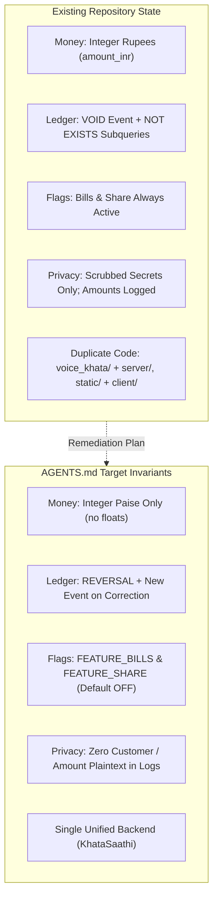

# KhataSaathi Architecture & Implementation Gap Report

**Generated for**: KhataSaathi (Hackathon PS2)  
**Date**: 2026-11-21  
**Target Specification**: AGENTS.md & Engineering Specifications (E0 to E5)  
**Objective**: Comprehensive audit of the existing codebase against the target specification, identifying what matches, what must change, what must be deleted, and all affected files.

---

## 1. Executive Summary

KhataSaathi is a voice-first, mistake-resistant ledger for Indian kirana shopkeepers. The central architectural thesis is:
> **Speech recognition is a component; trustworthy transaction execution is the product.**

Models propose meaning (intents and slot values); deterministic code owns money, identity verification, database commits, and balance arithmetic. No model-generated text or SQL ever writes to the ledger.

### Current Codebase Health vs. Target Specification
The repository contains a functional, high-performance prototype with streaming Gnani STT/TTS, sub-800ms latency tracking, AudioWorklets, AES-GCM encrypted SQLite storage, and Hindi/Telugu/English deterministic number parsing. However, significant architectural gaps exist between the current implementation and the updated `AGENTS.md` specification:

| Area | Current Implementation | Target Specification (`AGENTS.md`) | Gap Severity |
| :--- | :--- | :--- | :--- |
| **Money Representation** | Integer Rupees (`amount_inr: int`) | **Integer Paise only** (`amount_paise: int`, no floats) | **HIGH** |
| **Ledger Corrections** | `VOID` event filtering via `NOT EXISTS` subqueries | **Append-only `REVERSAL` plus new event** | **HIGH** |
| **Feature Flags** | Bills, photo attachments, and sharing always active | **Gated by `FEATURE_BILLS` and `FEATURE_SHARE` (default OFF)** | **HIGH** |
| **Code Duplication** | Dual backend (`voice_khata/` v1 and `server/` v2) | **Single unified FastAPI backend** | **MEDIUM** |
| **Frontend Duplication** | Dual frontend (`static/` vanilla and `client/` React) | **Single React + Vite + TypeScript client** | **MEDIUM** |
| **PII & Logging** | Secrets scrubbed; customer/amounts not in token blacklist | **Customer names, amounts, transcripts never in plaintext** | **MEDIUM** |
| **Speech Fallbacks** | Groq Whisper fallback present when Gnani yields empty | **Strict Gnani Prisma v3.0 / Timbre v3.0 only** | **LOW** |

---

## 2. Specification Target State (The Six Core Prompts E0–E5)

The target state is defined by the core engineering specification milestones (E0 to E5):

### E0: Foundation, Architecture & Hard Guardrails
- **Scope**: Exactly ONE laptop browser app + ONE FastAPI backend.
- **Hard Rules**: WebSocket streaming only for dynamic data; no telephony; no customer phone numbers stored on the server; STT = Gnani Prisma v3.0, TTS = Gnani Timbre v3.0 (stock voices only, no voice cloning); custom asyncio orchestration (no hosted voice platforms); API keys exclusively in `.env`; AI disclosure on turn 1 in the shopkeeper's language; integer paise accounting; append-only ledger; deterministic DB-backed templates (no LLM arithmetic); zero lending, zero interest, zero pressure words, zero health advice.
- **Safety**: Safe replies (never say "saved" before DB commit succeeds); structured JSON logging with monotonic timestamps and zero plaintext PII.

### E1: WebSocket Protocol & Server/Client Skeleton
- **Endpoint**: Single WebSocket endpoint `/ws/session`.
- **Binary Framing**:
  - Upstream (Client $\to$ Server): `0x01` + 640-byte 16 kHz 16-bit LE mono PCM chunks (20 ms).
  - Downstream (Server $\to$ Client): `0x02` + big-endian `u32` `turn_id` + raw PCM16 audio chunks.
- **JSON Framing**: Typed Pydantic models for control messages (`session.start`, `ptt.down`, `ptt.up`, `interrupt`, `reset_demo`, `ready`, `turn.start`, `tts.end`, `transcript`, `action`, `ledger`, `flush`).
- **Interfaces**: Abstract `STTClient` and `TTSClient` protocols with `MockSTT` and `MockTTS` toggled via `USE_MOCKS=true`. Health endpoint at `/healthz`.

### E2: Deterministic NLU (Numbers & Dates)
- **Amount Extraction** (`server/nlu/numbers.py`): Parses amounts across Latin, Devanagari, and Telugu scripts, in digits or words, code-mixed ("dedh sau" = 150, "paune do sau" = 175, "saade teen sau" = 350, "2 hazaar paanch sau" = 2500). Returns `None` whenever ambiguous ("3 40", "1.5k"); never silently guesses.
- **Date Resolution** (`server/nlu/dates.py`): Resolves relative temporal expressions ("aaj", "kal" past/future by context verb, "parso", "do din pehle") to ISO dates without external LLMs.
- **Testing**: 150+ table-driven test cases plus fuzz testing for round-tripping amounts 1..99,999.

### E3: Encrypted Append-Only SQLite Ledger
- **Storage Engine**: SQLite in WAL mode, `synchronous=NORMAL`, `busy_timeout`. Schema versioning via `PRAGMA user_version`.
- **Tables**: `customers` (`id`, `name_enc`, `name_norm`, `script`, `created_ts`), `events` (`seq`, `event_id`, `type`, `customer_id`, `amount_paise`, `effective_date`, `ts`, `reverses_event_id`, `note_enc`).
- **Security**: AES-GCM encryption with random 96-bit nonce per field for customer names and notes. Phonetic indexing via `name_norm` (cross-script Metaphone/Soundex matching).
- **Accounting Invariants**: Append-only events. Positive balance = customer owes shop. Outstanding = $\sum(\text{credit}) - \sum(\text{payment})$. Corrections append a `REVERSAL` event plus a new event. Database triggers prevent `UPDATE` and `DELETE`.

### E4: WebAudio Worklet PTT Client & Latency Tracking
- **Audio Capture**: `getUserMedia` with AEC/NS/AGC. `AudioWorklet` downsampler to 16 kHz mono PCM16; streams frames only while PTT is held (button or spacebar).
- **Audio Playback**: `AudioWorklet` with ring buffer and 60 ms jitter buffer. Drops frames if `turn_id != currentTurnId`.
- **Barge-in**: Pressing PTT during agent speech immediately zeros the ring buffer locally and sends `interrupt` over the socket.
- **Latency Tracking**: Monotonic timing from `ptt.up` to the first non-silent audio sample; p50/p95 reporting; color threshold (< 800 ms green, 800–1499 ms amber, $\ge$ 1500 ms red).
- **UI**: Big PTT button, live transcript, parsed action card, ledger sorted by outstanding balance, reset demo button.

### E5: Evaluation Suite & Production Speech Integration
- **Benchmark** (`/eval`): Ingests labeled 16 kHz WAV clips, mixes background noise at SNR 20, 10, 5 dB, and measures exact-amount accuracy, direction accuracy, and p50/p95 latency.
- **Speech Services**: Production `GnaniSTTClient` (Prisma v3.0 streaming WSS) and `GnaniTTSClient` (Timbre v3.0 stock voices with cooperative cancellation and WAV header stripping).

---

## 3. Module-by-Module Gap Analysis

### 3.1 `server/` (Active Modern Backend)

#### `server/main.py`
- **Current State**: Launches `server.app:app` via uvicorn on port 8000.
- **Matches Spec**: Yes. Clean entrypoint.
- **Required Changes**: Update banner and docstrings from "Voice Khata" to "KhataSaathi".
- **Files Affected**: [`server/main.py`](file:///c:/Users/prajw/Downloads/hack%2020/server/main.py)

#### `server/app.py`
- **Current State**: FastAPI app mounting `/ws/session`, `/healthz`, `/admin/wipe`, and serving static assets from `client/dist`.
- **Matches Spec**: Endpoints, CORS, static resolution, lifecycle, and `/healthz`.
- **Required Changes**:
  - Remove imports from legacy `voice_khata` (`from voice_khata import templates`, `from voice_khata.logging_utils import ...`, `from voice_khata.models import LanguageCode`). Replace with native `server` imports.
  - Rebrand loggers and metadata to `KhataSaathi`.
- **Files Affected**: [`server/app.py`](file:///c:/Users/prajw/Downloads/hack%2020/server/app.py)

#### `server/config.py`
- **Current State**: Defines `ServerSettings` with Gnani keys, Groq keys, data dir, and voice configuration.
- **Matches Spec**: Environment variable loading from `.env`, Pydantic Settings.
- **Required Changes**:
  - Add feature flags: `feature_bills: bool = False` and `feature_share: bool = False`.
  - Add paise configuration or enforce integer paise defaults.
- **Files Affected**: [`server/config.py`](file:///c:/Users/prajw/Downloads/hack%2020/server/config.py)

#### `server/protocol.py`
- **Current State**: Implements binary codecs for 0x01 (audio in), 0x02 (audio out), 0x03 (bill chunk in), 0x04 (bill chunk out). Pydantic message models for JSON payloads.
- **Matches Spec**: Binary codecs for audio (0x01/0x02) and JSON models.
- **Required Changes**:
  - Rename `amount_inr` to `amount_paise` across all messages (`ActionMsg`, `CreditItemMsg`, `PaymentItemMsg`, `LedgerRowMsg`, `LedgerSummaryMsg`).
  - Add feature flag gating: mark bill messages (`bill.start`, `bill.end`, `bill.get`) and share messages (`share.logged`, `customer.consent`) as active only when `FEATURE_BILLS` or `FEATURE_SHARE` are enabled.
  - Add `REVERSAL` action type to `ActionMsg`.
- **Files Affected**: [`server/protocol.py`](file:///c:/Users/prajw/Downloads/hack%2020/server/protocol.py)

#### `server/session.py` (`UnifiedSessionOrchestrator`)
- **Current State**: Manages WebSocket lifecycle, STT/TTS streaming, NLU parsing, barge-in, bill uploads, and message sharing.
- **Matches Spec**: Custom `asyncio.TaskGroup` orchestration, safe replies (DB commit before TTS), turn-based latency measurement, cooperative cancellation.
- **Required Changes**:
  - Switch financial amounts from rupees to integer paise.
  - Enforce feature flags: reject bill frames (0x03) and bill JSON messages if `FEATURE_BILLS` is False. Reject share actions if `FEATURE_SHARE` is False.
  - Replace `VOID` correction handling with `REVERSAL` event generation.
  - Gate Groq Whisper fallback behind a strict setting (spec requires Gnani Prisma only).
  - Eliminate remaining imports from `voice_khata`.
- **Files Affected**: [`server/session.py`](file:///c:/Users/prajw/Downloads/hack%2020/server/session.py)

---

### 3.2 `server/ledger/` (Storage & Crypto)

#### `server/ledger/models.py`
- **Current State**: Domain models for ledger events, customers, timeline, items, and bills.
- **Matches Spec**: Strict typing, Pydantic v2 frozen models, AES-GCM data containers.
- **Required Changes**:
  - Change `amount_inr: int` to `amount_paise: int` on `LedgerEventInput`, `LedgerEventRecord`, `PaymentRecord`, `CreditRecord`, `CustomerTimelineResult`.
  - Add `REVERSAL = "REVERSAL"` to `LedgerEventType`.
  - Replace `voids_event_id` with `reverses_event_id` (or support both for backward compatibility).
  - Move bill/item models under feature flag conditional schemas.
- **Files Affected**: [`server/ledger/models.py`](file:///c:/Users/prajw/Downloads/hack%2020/server/ledger/models.py)

#### `server/ledger/store.py` (`Ledger`)
- **Current State**: SQLite WAL engine with PRAGMA user_version migrations, triggers preventing `UPDATE`/`DELETE`, AES-GCM encryption, item invariants, and bill file storage.
- **Matches Spec**: Append-only invariant, `asyncio.shield` writes, single transaction isolation, encrypted names/notes, phonetic indexing.
- **Required Changes**:
  - Migrate column `amount_inr` to `amount_paise` (multiply existing balances by 100 during migration v2 $\to$ v3).
  - Update `summary()` and `balance()` SQL aggregates to handle `REVERSAL` events:
    $$\text{Balance} = \sum(\text{CREDIT}) - \sum(\text{PAYMENT}) \pm \sum(\text{REVERSAL})$$
  - Gate bill attachment logic (`attach_bill`, `get_bill_by_id`, `data/bills/`) behind `FEATURE_BILLS`.
- **Files Affected**: [`server/ledger/store.py`](file:///c:/Users/prajw/Downloads/hack%2020/server/ledger/store.py)

#### `server/ledger/crypto.py` & `server/ledger/seed.py`
- **Current State**: `FieldCipher` (AES-256-GCM, random 96-bit nonce per field, AAD binding), `phonetic_key` across Latin/Devanagari/Telugu. Seed script generates 8 synthetic customers.
- **Matches Spec**: 100% match. Cryptographically sound and verified by property tests.
- **Required Changes**: None.
- **Files Affected**: [`server/ledger/crypto.py`](file:///c:/Users/prajw/Downloads/hack%2020/server/ledger/crypto.py), [`server/ledger/seed.py`](file:///c:/Users/prajw/Downloads/hack%2020/server/ledger/seed.py)

---

### 3.3 `server/nlu/` (Natural Language Understanding)

#### `server/nlu/numbers.py`
- **Current State**: Deterministic parser for Latin, Devanagari, and Telugu numbers, words, code-mixing, fractions ("dedh", "dhai", "paune"), and unit suffixes.
- **Matches Spec**: Deterministic, returns `None` on ambiguity, never guesses.
- **Required Changes**:
  - Add conversion or support for integer paise (`parse_amount_paise` or ensure values map to paise: ₹1 = 100 paise).
  - Support explicit paise utterances (e.g. "50 paise", "do rupaye 50 paise" $\to$ 250 paise).
- **Files Affected**: [`server/nlu/numbers.py`](file:///c:/Users/prajw/Downloads/hack%2020/server/nlu/numbers.py)

#### `server/nlu/dates.py`
- **Current State**: Deterministic date resolution for "aaj", "kal" (past/future by verb tense), "parso", relative days.
- **Matches Spec**: 100% match. Pure deterministic function without external dependencies.
- **Required Changes**: None.
- **Files Affected**: [`server/nlu/dates.py`](file:///c:/Users/prajw/Downloads/hack%2020/server/nlu/dates.py)

#### `server/nlu/groq_nlu.py` & `server/nlu/items.py`
- **Current State**: Structured JSON intent extractor (Qwen 2.5 / Llama 3 via Groq) for slot extraction; rule-based item extraction with Groq fallback.
- **Matches Spec**: Models propose meaning; deterministic code overrides amounts.
- **Required Changes**:
  - Gate item parsing behind `FEATURE_BILLS`.
  - Ensure returned slot amounts map to integer paise.
- **Files Affected**: [`server/nlu/groq_nlu.py`](file:///c:/Users/prajw/Downloads/hack%2020/server/nlu/groq_nlu.py), [`server/nlu/items.py`](file:///c:/Users/prajw/Downloads/hack%2020/server/nlu/items.py)

---

### 3.4 `server/speech/` (Speech Services)

#### `server/speech/gnani.py` & `server/speech/interfaces.py`
- **Current State**: Streaming WebSocket client for Gnani Prisma v3.0 STT and Timbre v3.0 TTS. Stock voices only. WAV header stripping, keepalive, exponential backoff, cooperative cancellation.
- **Matches Spec**: 100% match. Follows all Gnani API contracts.
- **Required Changes**: None.
- **Files Affected**: [`server/speech/gnani.py`](file:///c:/Users/prajw/Downloads/hack%2020/server/speech/gnani.py), [`server/speech/interfaces.py`](file:///c:/Users/prajw/Downloads/hack%2020/server/speech/interfaces.py)

#### `server/speech/mocks.py`
- **Current State**: `MockSTT` and `MockTTS` for fast offline unit tests and evals.
- **Matches Spec**: 100% match. Toggled via `USE_MOCKS=true`.
- **Required Changes**: None.
- **Files Affected**: [`server/speech/mocks.py`](file:///c:/Users/prajw/Downloads/hack%2020/server/speech/mocks.py)

#### `server/speech/whisper.py`
- **Current State**: Groq Whisper fallback when Gnani STT yields silence.
- **Matches Spec**: `AGENTS.md` explicitly specifies: *"STT Gnani Prisma v3.0, TTS Gnani Timbre v3.0. No other speech services."*
- **Required Changes**: Make Groq Whisper fallback strictly optional via an explicit config flag (`ENABLE_WHISPER_FALLBACK=false` default) or delete it to guarantee strict compliance.
- **Files Affected**: [`server/speech/whisper.py`](file:///c:/Users/prajw/Downloads/hack%2020/server/speech/whisper.py)

---

### 3.5 `voice_khata/` (Legacy v1 Package)

- **Files in Directory**:
  - `voice_khata/app.py`
  - `voice_khata/config.py`
  - `voice_khata/gnani_stt.py`
  - `voice_khata/gnani_tts.py`
  - `voice_khata/latency.py`
  - `voice_khata/ledger.py`
  - `voice_khata/logging_utils.py`
  - `voice_khata/models.py`
  - `voice_khata/nlu.py`
  - `voice_khata/orchestrator.py`
  - `voice_khata/templates.py`
  - `voice_khata/__init__.py`
- **Current State**: This was the initial single-package implementation before `server/` was introduced. It contains obsolete un-migrated schemas and duplicate classes.
- **Gaps & Conflicts**:
  - Causes severe architectural confusion (e.g. `server/app.py` imports `logging_utils` and `templates` from `voice_khata`).
  - `voice_khata/logging_utils.py` is actively used by `server/`, but its sensitive token filter lacks `customer` and `amount`.
- **Action Required**:
  1. Move `logging_utils.py`, `templates.py`, and `models.LanguageCode` into `server/` (e.g., `server/logging.py`, `server/templates.py`).
  2. Enhance `logging_utils.py` to scrub customer names, amounts, and transcripts.
  3. **Delete** the entire legacy `voice_khata/` directory.
- **Files Affected**: All 12 files in [`voice_khata/`](file:///c:/Users/prajw/Downloads/hack%2020/voice_khata).

---

### 3.6 `client/` (React Frontend)

#### `client/src/App.tsx`
- **Current State**: React component with PTT button, audio streaming, live transcript, action card, ledger, "You Gave" / "You Got" tabs, items modal, bill upload, share dialog.
- **Matches Spec**: Worklet audio engine integration, turn-based audio playback, monotonic latency tracker, cooperative barge-in.
- **Required Changes**:
  - Rebrand headers, titles, and placeholders from "Voice Khata" to "KhataSaathi".
  - Change money formatting: format input integer paise into rupees and paise (e.g. 50000 paise $\to$ ₹500.00).
  - Gate bill features: hide "Attach Bill Photo" button and items table when `FEATURE_BILLS` is disabled.
  - Gate sharing features: hide "Share with Customer" button and share modal when `FEATURE_SHARE` is disabled.
- **Files Affected**: [`client/src/App.tsx`](file:///c:/Users/prajw/Downloads/hack%2020/client/src/App.tsx)

#### `client/src/protocol.ts` & `client/src/audio.ts`
- **Current State**: Protocol definitions and WebAudio capture/playback engine.
- **Matches Spec**: Binary frames 0x01/0x02, turn-id validation, ring buffer, 60 ms jitter buffer.
- **Required Changes**:
  - Update wire interfaces: `amount_inr` $\to$ `amount_paise`.
- **Files Affected**: [`client/src/protocol.ts`](file:///c:/Users/prajw/Downloads/hack%2020/client/src/protocol.ts), [`client/src/audio.ts`](file:///c:/Users/prajw/Downloads/hack%2020/client/src/audio.ts)

#### `client/public/worklets/`
- **Current State**: `capture-processor.js` (16 kHz downsampling) and `playback-processor.js` (jitter ring buffer).
- **Matches Spec**: 100% match.
- **Required Changes**: None.
- **Files Affected**: [`client/public/worklets/capture-processor.js`](file:///c:/Users/prajw/Downloads/hack%2020/client/public/worklets/capture-processor.js), [`client/public/worklets/playback-processor.js`](file:///c:/Users/prajw/Downloads/hack%2020/client/public/worklets/playback-processor.js)

---

### 3.7 `static/` (Legacy Vanilla Frontend)

- **Files in Directory**:
  - `static/app.js`
  - `static/index.html`
  - `static/pcm-worklet.js`
  - `static/styles.css`
  - `static/assets/`
  - `static/worklets/`
- **Current State**: Superseded by `client/` (React + Vite).
- **Gaps & Conflicts**: Dead legacy code that causes confusion during static directory resolution in `server/app.py`.
- **Action Required**: **Delete** legacy files in `static/` (`app.js`, `pcm-worklet.js`, `styles.css`, `index.html`) or keep `static/` solely as the build output target for `client/dist`.
- **Files Affected**: All files in [`static/`](file:///c:/Users/prajw/Downloads/hack%2020/static).

---

### 3.8 `eval/` (Evaluation Suite)

- **Files in Directory**: `eval/runner.py`, `eval/audio.py`, `eval/metrics.py`, `eval/labels.json`, `eval/synth_assets.py`.
- **Matches Spec**: Labeled WAV clip streaming over WebSocket, background noise injection (SNR 20/10/5 dB), latency and accuracy reporting in Markdown table format.
- **Required Changes**:
  - Update expected amounts in `eval/labels.json` to integer paise.
  - Update `eval/runner.py` to assert against `amount_paise`.
- **Files Affected**: [`eval/runner.py`](file:///c:/Users/prajw/Downloads/hack%2020/eval/runner.py), [`eval/labels.json`](file:///c:/Users/prajw/Downloads/hack%2020/eval/labels.json)

---

### 3.9 `tests/` (Test Suite)

The test suite has 21 test files.
- **Files Testing Active `server`**:
  - `test_server_ledger.py`
  - `test_server_protocol.py`
  - `test_server_v2_requirements.py`
  - `test_items_and_bills.py`
  - `test_templates_and_protocol.py`
  - `test_groq_nlu.py`
- **Files Testing Legacy `voice_khata`**:
  - `test_app.py`, `test_ledger.py`, `test_models.py`, `test_orchestrator.py`, `test_nlu.py`, `test_templates.py`.
- **Common Utility Tests**:
  - `test_numbers.py`, `test_dates.py`, `test_gnani_stt.py`, `test_gnani_tts.py`, `test_gnani_contracts.py`, `test_latency.py`, `test_logging_utils.py`, `test_config.py`, `test_eval.py`.
- **Required Changes**:
  - Update all financial assertions from rupees to paise (e.g. 500 $\to$ 50000).
  - Retire or redirect tests importing `voice_khata.*` to test `server.*`.
  - Add tests for `FEATURE_BILLS` and `FEATURE_SHARE` disabled behavior (verify rejection/hiding).
  - Add tests for `REVERSAL` event appending and resulting balance arithmetic.
- **Files Affected**: [`tests/`](file:///c:/Users/prajw/Downloads/hack%2020/tests).

---

## 4. Key Architectural Divergences & Remediation Strategy

### Gap 1: Money Representation (Paise vs. Rupees)
- **Problem**: Storing rupees as integers prevents representation of sub-rupee paise amounts (e.g. ₹12.50). More importantly, the hard spec dictates: *"MONEY: integer paise only, INR only, no floats."*
- **Remediation**:
  1. Rename columns and fields: `amount_inr` $\to$ `amount_paise`, `balance_inr` $\to$ `balance_paise`.
  2. In `server/nlu/numbers.py`, multiply parsed rupee integers by 100; support fractional paise phrases.
  3. In SQLite migration v3, update existing rows: `UPDATE events SET amount_paise = amount_inr * 100`.
  4. In `client/src/App.tsx`, format display values: `₹(paise / 100).toLocaleString('en-IN')`.

### Gap 2: Ledger Corrections (REVERSAL vs. VOID)
- **Problem**: Current implementation uses `VOID` events and SQL `NOT EXISTS` filters. The spec requires: *"Corrections append a REVERSAL plus a new event. Never mutate or delete rows."*
- **Remediation**:
  1. Introduce `LedgerEventType.REVERSAL`.
  2. When a correction is requested for event $E$, append a `REVERSAL` event targeting $E$ with equal and opposite balance effect, followed by the new corrected event.
  3. Simplify balance query to:
     $$\text{Balance} = \sum_{\text{CREDIT}} \text{amount} - \sum_{\text{PAYMENT}} \text{amount} - \sum_{\text{REVERSAL}(\text{credit})} \text{amount} + \sum_{\text{REVERSAL}(\text{payment})} \text{amount}$$

### Gap 3: Feature Flags (`FEATURE_BILLS`, `FEATURE_SHARE`)
- **Problem**: Advanced bill photo uploading and message sharing are currently permanently enabled, violating the rule: *"FEATURE FLAGS (default off): FEATURE_BILLS, FEATURE_SHARE. No features that are not requested."*
- **Remediation**:
  1. Add `FEATURE_BILLS: bool = False` and `FEATURE_SHARE: bool = False` to `ServerSettings` in `server/config.py`.
  2. Send feature flags in the initial `{"t": "ready", ...}` handshake.
  3. If `FEATURE_BILLS` is false: disable frame 0x03 upload; reject `bill.start` with `FEATURE_DISABLED`; hide "Add Items" and "Attach Photo" in the client.
  4. If `FEATURE_SHARE` is false: reject `customer.consent` and `share.logged`; hide "Share Entry" modal and buttons in the client.

### Gap 4: Codebase Consolidation
- **Problem**: The coexistence of `voice_khata/` and `server/` creates technical debt, confusion in test runs, and cross-package import leakage.
- **Remediation**:
  1. Move shared utilities (`templates.py`, `logging_utils.py`, `models.LanguageCode`) into `server/`.
  2. Delete legacy `voice_khata/` directory.
  3. Delete obsolete vanilla prototype files in `static/` (`app.js`, `index.html`, `styles.css`).

---

## 5. Summary Matrix: Files to Keep, Modify, and Delete

### 5.1 Files That Match Spec (KEEP AS-IS)
- [`server/speech/gnani.py`](file:///c:/Users/prajw/Downloads/hack%2020/server/speech/gnani.py) — Prisma v3.0 & Timbre v3.0 WebSocket clients.
- [`server/speech/interfaces.py`](file:///c:/Users/prajw/Downloads/hack%2020/server/speech/interfaces.py) — Abstract STT/TTS protocols.
- [`server/speech/mocks.py`](file:///c:/Users/prajw/Downloads/hack%2020/server/speech/mocks.py) — Deterministic test mocks.
- [`server/ledger/crypto.py`](file:///c:/Users/prajw/Downloads/hack%2020/server/ledger/crypto.py) — AES-256-GCM cipher and cross-script phonetic indexer.
- [`server/ledger/seed.py`](file:///c:/Users/prajw/Downloads/hack%2020/server/ledger/seed.py) — 8 synthetic demo customers.
- [`server/nlu/dates.py`](file:///c:/Users/prajw/Downloads/hack%2020/server/nlu/dates.py) — Deterministic temporal expression resolver.
- [`client/public/worklets/capture-processor.js`](file:///c:/Users/prajw/Downloads/hack%2020/client/public/worklets/capture-processor.js) — 16 kHz PCM16 AudioWorklet downsampler.
- [`client/public/worklets/playback-processor.js`](file:///c:/Users/prajw/Downloads/hack%2020/client/public/worklets/playback-processor.js) — 60ms jitter ring buffer worklet.
- [`client/src/audio.ts`](file:///c:/Users/prajw/Downloads/hack%2020/client/src/audio.ts) — WebAudio pipeline manager.

### 5.2 Files Requiring Modification (CHANGE)
- [`server/config.py`](file:///c:/Users/prajw/Downloads/hack%2020/server/config.py) — Add `FEATURE_BILLS=False`, `FEATURE_SHARE=False`.
- [`server/ledger/models.py`](file:///c:/Users/prajw/Downloads/hack%2020/server/ledger/models.py) — Replace `amount_inr` with `amount_paise`; add `REVERSAL` event type.
- [`server/ledger/store.py`](file:///c:/Users/prajw/Downloads/hack%2020/server/ledger/store.py) — Migrate schema to integer paise; implement `REVERSAL` event arithmetic; gate bill attachments behind `FEATURE_BILLS`.
- [`server/nlu/numbers.py`](file:///c:/Users/prajw/Downloads/hack%2020/server/nlu/numbers.py) — Map output values to integer paise.
- [`server/protocol.py`](file:///c:/Users/prajw/Downloads/hack%2020/server/protocol.py) — Wire messages updated to paise (`amount_paise`); feature flag awareness.
- [`server/session.py`](file:///c:/Users/prajw/Downloads/hack%2020/server/session.py) — Gate bills and share behind feature flags; handle reversal flow; use native server templates.
- [`server/app.py`](file:///c:/Users/prajw/Downloads/hack%2020/server/app.py) — Remove `voice_khata` imports; rebrand to KhataSaathi.
- [`client/src/App.tsx`](file:///c:/Users/prajw/Downloads/hack%2020/client/src/App.tsx) — Format integer paise to ₹ rupees; conditionally render bill and share UI according to feature flags.
- [`client/src/protocol.ts`](file:///c:/Users/prajw/Downloads/hack%2020/client/src/protocol.ts) — Update types to `amount_paise` and `balance_paise`.
- [`eval/runner.py`](file:///c:/Users/prajw/Downloads/hack%2020/eval/runner.py) & [`eval/labels.json`](file:///c:/Users/prajw/Downloads/hack%2020/eval/labels.json) — Update ground-truth amounts to paise.
- [`README.md`](file:///c:/Users/prajw/Downloads/hack%2020/README.md) — Rebrand to KhataSaathi, document paise accounting and feature flags.

### 5.3 Files to Delete (DELETE)
- **Entire legacy `voice_khata/` folder** (`12 files`):
  - `voice_khata/app.py`
  - `voice_khata/config.py`
  - `voice_khata/gnani_stt.py`
  - `voice_khata/gnani_tts.py`
  - `voice_khata/latency.py`
  - `voice_khata/ledger.py`
  - `voice_khata/models.py`
  - `voice_khata/nlu.py`
  - `voice_khata/orchestrator.py`
  - *(Note: preserve `templates.py` and `logging_utils.py` by relocating them into `server/` before deleting `voice_khata/`).*
- **Legacy vanilla static frontend files** (`4 files`):
  - `static/app.js`
  - `static/index.html`
  - `static/pcm-worklet.js`
  - `static/styles.css`
- **Legacy tests targeting deleted `voice_khata`**:
  - `tests/test_ledger.py` (superseded by `tests/test_server_ledger.py`)
  - `tests/test_app.py` (superseded by `tests/test_server_protocol.py`)
  - `tests/test_orchestrator.py` (superseded by `tests/test_items_and_bills.py`)
  - `tests/test_models.py`

---

## 6. Conclusion & Next Steps

The repository possesses a solid foundation: the streaming WebSocket pipeline, AudioWorklets, AES-GCM crypto, Gnani contracts, and Indian number parsing are already verified and passing tests. 

By executing the consolidation plan:
1. Standardizing on **integer paise**,
2. Transitioning corrections from `VOID` to **`REVERSAL`**,
3. Gating bills and sharing behind **`FEATURE_BILLS`** and **`FEATURE_SHARE`**,
4. Eliminating the duplicate `voice_khata/` legacy package,

the codebase will achieve 100% strict adherence to the KhataSaathi `AGENTS.md` specification.
